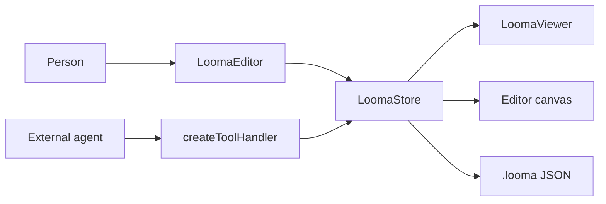

# Architecture

Looma keeps a single document in a store. The viewer draws it. The editor adds selection and text fields on top of the same tree. An external agent uses the same commands as the editor, through a tool handler, and never writes into React state.

There is no second document inside the editor. A text field holds a draft until it commits a command. Everything else reads `store.getDocument()`.

## Store

`createLoomaStore` validates the initial document and freezes it. `apply` runs the command batch with Immer's `produceWithPatches`. The batch is one transaction:

1. Each command is parsed. A schema error stops the batch before any change.
2. Commands run against one draft. A semantic error (a missing id, a container nested too deep, an asset that does not exist) aborts the draft.
3. The resulting document is checked again. If that check fails, the draft is discarded.
4. On success the frozen next document replaces the current one, and the forward and inverse patches are pushed onto the undo stack.

The default history holds 200 entries. Undo and redo apply those patches; they do not re-run commands. `load` swaps the whole document and clears both stacks.

### Merge window

`apply` accepts `origin`, `label`, and `mergeKey`. When two successful applies share `origin` and `mergeKey` and land within `mergeWindowMs` (default 1000), they fold into the current undo entry. The editor uses this for the title (`mergeKey: "title"`) and for speaker notes (`mergeKey: "notes:<cardId>"`), so a pause in typing is one undo step rather than one step per key. A new gesture, a different origin, or a gap longer than the window starts a new entry.

`origin` is also how the editor tells a person from an agent. The default is `'user'`. The tool handler defaults to `'ai'`. The editor flashes cards and blocks touched by any apply whose origin is not `'user'`.

Listeners receive the next document and a `StoreChange`: `kind` is `apply`, `undo`, `redo`, or `load`, plus `origin`, `commands`, `touchedIds`, and `removedIds`.

## Rendering

`LoomaRoot` writes the theme onto the element as CSS variables: `--lm-color-bg`, `--lm-color-fg`, `--lm-font-heading`, `--lm-card-background`, `--lm-radius`, and the rest of the override whitelist. Component styles read those variables. They do not read a theme object at paint time.

`ScaledFrame` gives every card a stable logical size and scales it into the container:

| Format         | Logical size        | Fit                         |
| -------------- | ------------------- | --------------------------- |
| `presentation` | 1280 × 720          | Contain, letterboxed        |
| `document`     | 816 wide, auto tall | Width, no vertical clipping |

The frame measures the outer box, computes a scale, and applies `translate` plus `scale` with the origin at the top left. Until the outer box has a width, the inner tree is `visibility: hidden`, so a card does not flash at the wrong size.

`surfaceVariables` compares the card background with the theme's card surface. When the card is a light color on a dark theme, or the reverse, it overrides the foreground palette for that card only. The goal is readable text, not a second theme.

`useCardOverflow` measures `[data-lm-card-content]` against the 720px logical height. It reports overflowing card ids from the viewer and paints a badge on the editor's sidebar. Document format is not measured, because those pages are allowed to grow.

## Editor

The editor is a viewer plus four pieces of local UI state, held in `createViewState`:

- `selection` — the current card and node ids
- `editing` — the node id, slot, and caret of the open text field, if any
- `flashIds` — ids currently highlighted after an external change
- drag, slash-menu, and notice state

None of that is serialized. `useLoomaDocument(store)` is the only subscription to document data. The canvas asks the viewer to render each node, and `renderSlot` swaps a text slot for an editor when `editing` matches that node and slot.

### Text fields

ProseMirror (TipTap) edits inline slots: headings, paragraphs, lists, tables, callouts, and quotes. A plain textarea edits `code`, because code is literal text and must not go through the inline parser. Both debounce commits by 800ms. The title field and the speaker-notes field debounce by 600ms. `LoomaEditorHandle.flush()` runs the active field's commit immediately, then commits the title and notes drafts, and returns `store.getDocument()`. Export and any other snapshot should call `flush()` first.

Leaving a field, pressing Escape, or starting playback also commits the open text field. If an external command changes the slot that is being edited, the editor drops the draft, shows a notice, and reloads the field from the store so the two sides do not diverge.

### Commands from the chrome

The toolbar, sidebar, inspector, and keyboard shortcuts call `store.apply` with `origin: 'user'`. They do not mutate the document. Dragging a card builds a `moveCard` command. Changing a block's alignment builds an `updateNode` command. Deleting builds `deleteNode` or `deleteCard`. The same commands are what an agent sends through `looma_apply`.

Selection is pruned after every store change. If the selected id disappeared, the editor selects a neighbor or clears the selection. It does not try to resurrect a deleted node.

## What is intentionally outside

Looma does not ship a model client, a chat transcript, or a plugin sandbox. `@lor-looma/core/ai` exports a guide string, JSON Schemas, and a function that turns a tool call into `getOutline`, `getCards`, or `apply`. The playground's AI Console is a host: it is not part of the editor package. A product embeds the editor, keeps its own agent runtime, and points that runtime at the store.
